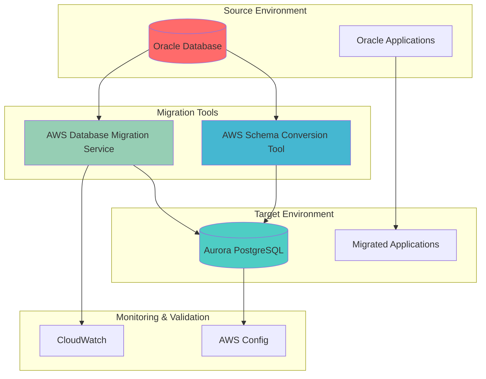

# Oracle to PostgreSQL Migration with AWS DMS

Heterogeneous database migration from Oracle to Aurora PostgreSQL using AWS Database Migration Service and Schema Conversion Tool — minimal downtime, automated schema conversion, and continuous change data capture.

## Problem

Enterprise organizations running Oracle databases face escalating licensing costs, vendor lock-in constraints, and complex maintenance requirements. Many companies pay millions annually in Oracle licensing fees while struggling with restrictive audit policies and limited scaling flexibility. The inability to quickly adapt database infrastructure creates technical debt and competitive disadvantages, forcing organizations to seek modernization paths that reduce costs while maintaining mission-critical performance.

## Solution

AWS Database Migration Service (DMS) combined with AWS Schema Conversion Tool (SCT) provides a comprehensive solution for migrating Oracle databases to PostgreSQL with minimal downtime and automated schema conversion. SCT analyzes and converts Oracle schemas, procedures, and functions to PostgreSQL-compatible formats, while DMS handles data migration with continuous replication. The result: significant cost savings, eliminated vendor lock-in, and access to modern PostgreSQL features and cloud-native scalability.

## Architecture

## Key Features

- **Schema conversion with AWS SCT** — automated conversion of Oracle PL/SQL procedures, functions, triggers, and data types to PostgreSQL equivalents with assessment reports
- **Full-load-and-CDC migration** — initial bulk load followed by continuous change data capture for minimal downtime
- **Table mapping and transformation rules** — schema renaming, lowercase conversion, and selection filters
- **Aurora PostgreSQL target** — managed, cloud-native PostgreSQL with automated backups, Performance Insights, and 128TB auto-scaling storage
- **Replication monitoring** — CloudWatch alarms for replication lag and migration errors via SNS
- **Post-migration validation** — row count comparison, data type checks, foreign key verification, and query performance testing

## AWS Services

| Service | Purpose |
|---|---|
| DMS | Data migration engine with full-load and CDC replication |
| Aurora PostgreSQL | Managed PostgreSQL migration target |
| SCT | Heterogeneous schema conversion (Oracle → PostgreSQL) |
| RDS | Aurora cluster and subnet group management |
| CloudWatch / SNS | Replication lag and error monitoring |
| IAM | Least-privilege DMS VPC and CloudWatch Logs roles |
| EC2 / VPC | Isolated network for migration infrastructure |

## Prerequisites

1. AWS account with DMS, RDS, and SCT permissions (DMS, RDS, IAM full access)
2. AWS CLI v2 installed and configured (or AWS CloudShell)
3. Oracle database with appropriate privileges (DBA or equivalent access)
4. Java 8 or later installed for running AWS SCT
5. Network connectivity between source Oracle and target PostgreSQL databases
6. Understanding of Oracle PL/SQL and PostgreSQL procedures
7. Estimated cost: **$150–300** for Aurora PostgreSQL instance during migration period

> **Warning:** This migration process involves schema conversion and data transformation that may require application code modifications. Test thoroughly in a non-production environment first.

## Implementation Overview

1. **VPC and networking** — dedicated VPC, subnets across AZs, security groups, and DMS/Aurora subnet groups
2. **Aurora PostgreSQL target** — cluster with automated backups, Performance Insights, and monitoring
3. **AWS SCT setup** — install the Schema Conversion Tool and configure source/target connections
4. **DMS IAM roles** — VPC management and CloudWatch Logs service roles
5. **DMS replication instance** — Multi-AZ compute engine for migration processing
6. **Source and target endpoints** — Oracle source with LogMiner settings, PostgreSQL target with batch/DDL capture
7. **Schema conversion** — SCT assessment and conversion of PL/SQL objects to PL/pgSQL
8. **Migration task** — full-load-and-CDC task with table mapping and transformation rules
9. **Task execution and monitoring** — start replication with real-time table statistics
10. **Converted schema application** — deploy procedures, functions, and indexes to PostgreSQL
11. **Monitoring and alerting** — CloudWatch alarms for replication lag and migration errors
12. **Post-migration validation** — row counts, data types, constraints, and performance testing

## Validation & Testing

- Verify migration task status reaches `running`/`stopped` with successful completion statistics
- Compare record counts and sample data between Oracle source and PostgreSQL target
- Test converted functions and verify index creation
- Run `EXPLAIN ANALYZE` performance comparisons on migrated tables

## Cleanup

Stop the replication task, delete DMS resources (tasks, endpoints, replication instance), delete the Aurora PostgreSQL cluster, remove CloudWatch alarms and SNS topics, and tear down all VPC networking components. Full cleanup commands are documented in the implementation steps.

## License

This project is licensed under the [MIT License](LICENSE).
